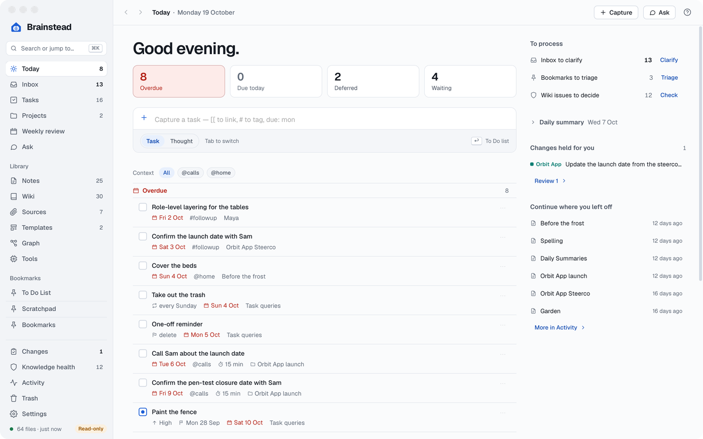
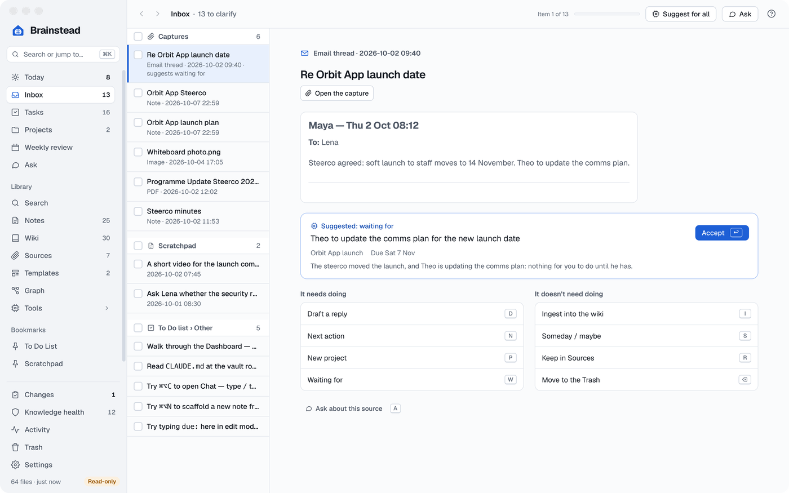
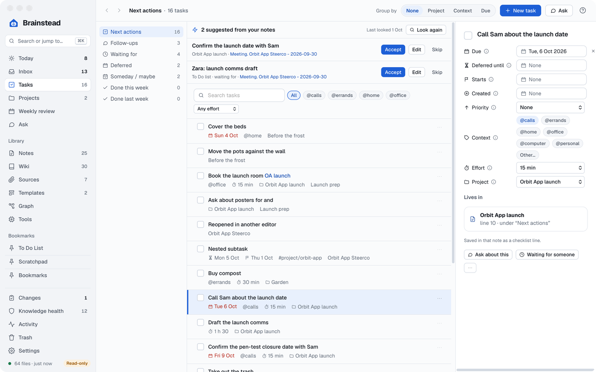
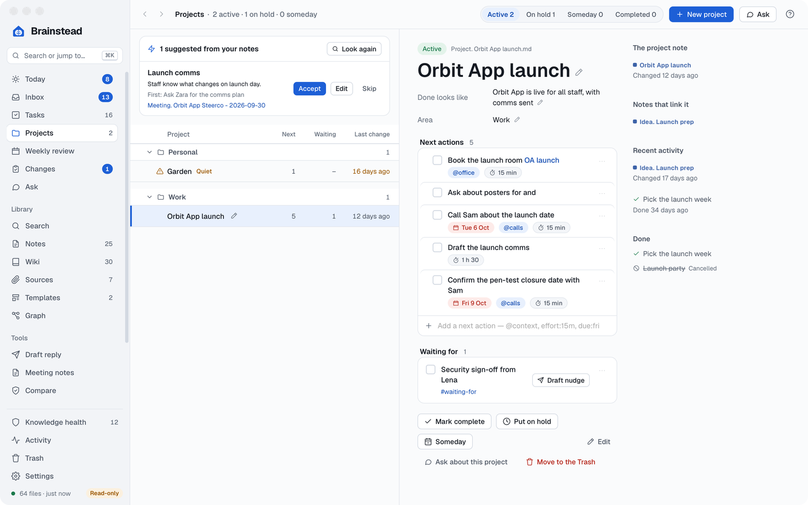
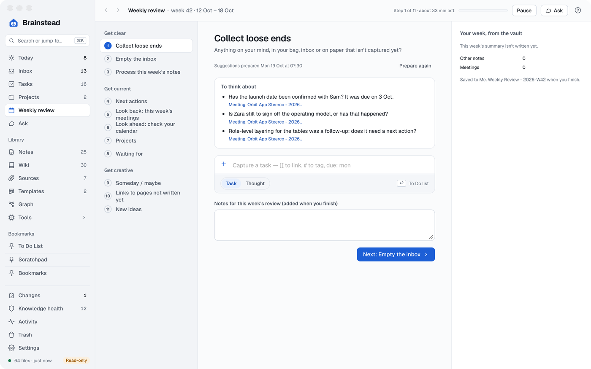

# Tasks and GTD

Brainstead runs [Getting Things Done](https://gettingthingsdone.com) (GTD) over the tasks already in your notes. A task is a `- [ ]` line in any note. Brainstead gathers them into lists, and each change rewrites only that one line, so other markdown editors see the same task.

[Today](#today) · [Quick capture](#quick-capture) · [The Inbox](#the-inbox) · [Tasks](#tasks) · [Projects](#projects) · [The weekly review](#the-weekly-review) · [How tasks are written](#how-tasks-are-written)

## Today

On Windows, ⌘ is Ctrl, so Today's ⌘1 is Ctrl+1, and the other screen shortcuts follow it up to 0.

<a href="images/index.md#tasks-and-gtd"><picture><source media="(prefers-color-scheme: dark)" srcset="images/today-dark.png"></picture></a>

Today (⌘1) is what needs you now:

- The day in one sentence under the greeting, each count a link to its band, then bands for **Overdue**, **Due today**, **Deferred until now**, **Coming up this week** (due in the next seven days) and **Waiting for**. On a wide window the last three sit beside the first two. A task deferred to a later day stays off Today until then, even if it's due. Tick, date and change tasks in place; ⌘Z undoes.
- `@context` chips to show one context.
- A capture box, the same as Quick capture.
- **To process**: the Inbox, bookmarks to triage, wiki issues to decide, and the weekly review on its day.
- The latest **Weekly summary** and **Daily summary**.
- **Changes held for you** to accept or reject, and **Continue where you left off**.

A waiting-for row shows how many days it has waited. **Draft nudge** drafts a follow-up with Ask to copy into Outlook or Teams; nothing is sent.

## Quick capture

Press ⌃⌥Space in any app (change it in Settings › General).

- Type a task and press ↩. It goes on the To Do list under Other.
- Press Tab for a **Thought**. It goes to the Scratchpad under a date and time heading.
- As you type, `due: fri`, `defer: +3d`, `@calls` and `effort:15m` become the task format. `[[` links a note and `#` adds a tag.

Both kinds wait in the Inbox.

## The Inbox

<a href="images/index.md#tasks-and-gtd"><picture><source media="(prefers-color-scheme: dark)" srcset="images/inbox-dark.png"></picture></a>

The Inbox (⌘2) lists what you've captured but not decided: emails and Teams chats from the browser extensions, sources added to `sources/` and not yet ingested, Scratchpad thoughts, and tasks under Other on the To Do list. Pick one (`J` and `K` move) and choose what it becomes. A suggestion from the AI shows first, and `↩` accepts it; the choices are in two lists, **It needs doing** and **It doesn't need doing**:

| Key | Choice |
|---|---|
| `N` | Next action, with its project, context, effort and due date |
| `P` | A new project |
| `W` | Waiting for |
| `2` | Done now (under 2 min) |
| `S` | Someday / maybe |
| `R` | File as reference in a note, or keep a capture in Sources |
| `⌫` | Delete |

Tick several items (a section's header box ticks them all) to act on them together: make meeting notes, ingest, keep in Sources, mark done, move to Someday / maybe or delete. One that fails doesn't stop the rest: it stays ticked and the message says why. Next action, Waiting for and New project stay one at a time.

A capture offers only the choices that fit its kind. A transcript: make a meeting note (`M`), ingest (`I`), ask about it (`A`), keep in Sources (`R`) or delete. An email or chat thread: draft a reply (`D`), ingest, ask, Next action, New project, Waiting for, Someday / maybe, keep in Sources or delete. Any other capture: the same without the reply or Waiting for. A capture has no Done now, and only a thread can be Waiting for. **Ask about this source** starts a chat about it in Ask, where a **Still in the Inbox** strip takes it out when you're done. A transcript stays in the Inbox until its meeting note is made and ingested; if either fails it stays, to be chosen again. Suggest only suggests what the Inbox offers for that kind of item. **Suggest for all** suggests a choice for the first 20 items; ↩ accepts one. ⌘Z undoes each choice.

## Tasks

<a href="images/index.md#tasks-and-gtd"><picture><source media="(prefers-color-scheme: dark)" srcset="images/task-pane-dark.png"></picture></a>

Tasks (⌘3) has the GTD lists: **Next actions**, **Follow-ups**, **Waiting for**, **Deferred**, **Someday / maybe**, and **Done this week** and **last week**. Next actions leaves out deferred tasks until their day, Inbox tasks until you clarify them, and the tasks of a project that's On hold or Someday until it's active again (the task's `projectStatus`, read from its project note's `status`; they still show on the project's page).

- Only tasks in your notes count. A checklist in a wiki page, a source or a template isn't listed here, counted in the tray or Projects, or listed by an assistant.
- Tick to finish a task; a recurring one gets its next occurrence. ⌘Z undoes.
- The ⋯ menu, a right-click or the pane on the right renames a task, sets dates, priority, context, effort and project, marks a task in progress or waiting for, cancels, deletes or opens its note.
- Drag rows into your own order, kept in the file as `^rank-N`. **Sort** switches to **By priority**: highest first, tasks with no priority last, same-priority tasks in your order. Each row shows its priority as a chip. Drag only works in **Manual order**.
- Keys: `↑` `↓` choose, `↩` opens, `Space` ticks, `⌫` deletes (⌘Z puts it back), `/` searches. They work on Today, Projects and the weekly review too.
- **Search tasks** narrows every list to tasks matching all its words.
- Group by **Project**, **Context**, **Due** or **Priority**, filter by context and effort, and **Save this list…**.
- **New task** takes the current list's tag and context. From a list with neither, it waits in the Inbox.
- **Find tasks and projects** has an assistant read your last 90 days of notes for tasks and projects you haven't written down. Each suggestion quotes its note; **Accept**, **Edit** or **Skip** it. Accepted ones are listed in Changes with Revert. It runs only when you start it.

## Projects

<a href="images/index.md#tasks-and-gtd"><picture><source media="(prefers-color-scheme: dark)" srcset="images/projects-dark.png"></picture></a>

A project is a note named `Project. <name>.md`, with its status, area and outcome as properties. Its tasks are the ones written in it, the ones in its documents, and any that link it. Projects (⌘4) lists them by status and area.

A note is one of a project's documents when one of its first 15 lines after the properties says `Project: [[Project. <name>]]` (an alias is fine; indented is fine; a `Project::` field, a bold label, or a line in code or an HTML comment doesn't count; only the first such line counts; notes only, not the wiki, sources or templates). Its tasks belong to that project unless a task's own line links another, or a project note that isn't there; the task pane then says **From its note's Project: line** in place of Clear. The project's page lists its documents by type (Tracker, Plan, Findings, Review, Ticket, Prompt, Other) with each one's `summary` property, and shows its tracker's **Current state** under the project's name. A tracker's shape is `## Current state`, `## Blockers`, `## Next` and `## Log` (dated lines, newest first) after the `Project:` line, other sections below; an assistant can reshape a tracker to it and write its Current state and Log lines, each a change in Changes.

An active project with no next action says **No next action** in red, and one where nothing has moved for two weeks says **Quiet** in amber. Add next actions, edit the outcome, area and status, and draft nudges for waiting-fors. **New project** writes the note with its headings.

A project's page also has a **Tickets and links** card: each ticket key and link written in the project note's properties, its documents' properties and its open tasks, once each, with where it appears (**Project note**, a document's title, **Next action**, **Waiting for** or **Someday / maybe**). It appears only once a reference prefix is set, and is left out when there is nothing to list. `list_projects` gives the same as its `references`, and none without a prefix.

- Click an area to fold its projects away; what's folded is remembered. Its pencil renames the area on every project under it; it keeps its place in the order, and undoing the rename (the toast's Undo, ⌘Z, Revert in Changes) puts it back where it was.
- Drag an area, or a project within its area, by its grip to put them in order. The order is a Brainstead setting, not written to your notes; ones never moved come after, A to Z.
- Click the project's name on its page to rename it; its note is renamed and links to it follow.
- The pencil on a project's row, or **Edit** on its page, opens the project note in Edit.

In the daily and weekly summaries, area Personal goes under **Personal** and any other area under **Work done** ([Day to day](day-to-day.md)).

## The weekly review

<a href="images/index.md#tasks-and-gtd"><picture><source media="(prefers-color-scheme: dark)" srcset="images/weekly-dark.png"></picture></a>

The weekly review walks you through GTD's three phases, Get clear, Get current and Get creative, in eleven steps over your real lists, acting on each item as you go.

- Open it from **Weekly review** in the sidebar, or **Start** on Today from the review's time (Friday 16:00 by default, in Settings › Jobs & schedule).
- **Pause** keeps your place.
- **Finish and save** writes the week's review note. ⌘Z undoes it.

On a Monday or Tuesday it covers the week just ended, otherwise this week. The scheduled weekly summary is separate, and reads your review note.

With an AI assistant set up, each step shows suggestions from your week, such as a task to add from a meeting, or one to tick, defer or reword. Nothing changes until you click, and each one can be undone. Assistants use `weekly_review`, `weekly_suggestion` and `weekly_step`.

## How tasks are written

Tasks follow the widely used Tasks format, so other markdown editors read them:

```markdown
- [ ] Call Sam about the launch date #context/calls [effort:: 15m] 📅 2026-10-06 ^rank-2048
- [ ] Security sign-off from Lena #waiting-for ➕ 2026-09-30
- [x] Send the steerco pack ✅ 2026-10-02
```

- Dates: `📅` due, `⏳` deferred until, `🛫` start, `➕` created, `✅` done, `❌` cancelled.
- Priority: `🔺` highest, `⏫` high, `🔼` medium, `🔽` low, `⏬` lowest.
- Repeat: a rule such as `🔁 every week`.
- A deferred task stays off Next actions until its day. A start date doesn't hide a task; it only makes it less urgent until then.
- A context is a `#context/<name>` tag, and effort a `[effort:: …]` field.
- `#followup`, `#waiting-for` and `#someday-maybe` put a task on those lists.
- A task belongs to a project when it's in the project's note, links it, or is in one of its documents (a note whose `Project:` line names it) without linking another project.
- Tasks inside quotes and callouts (`> - [ ] …`) count too.
- A link is `[label](https://example.com)` and a bare web address works too. A row shows the label (or the domain) as a link that opens in your browser; a click doesn't select the row. In an Inbox list row it is plain text, since the row is itself a button. A ticket key such as `ORBIT-12` is a link when its prefix is set under Reference links in Settings › Notes ([Notes](notes.md#reference-links)). Write each key once, on the task or the note it belongs to.

The app shows dates and fields as icons and plain text under the task, never the emoji.
